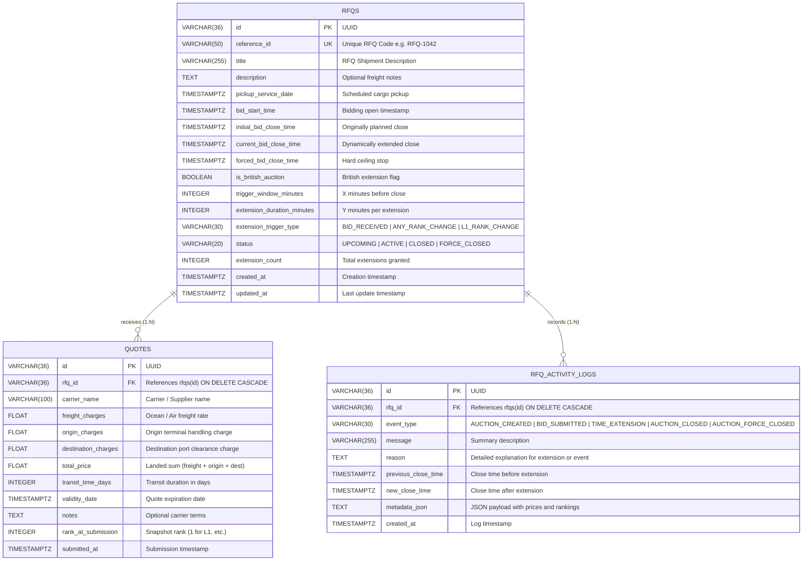

# Database Schema Design: British Reverse Auction in RFQ System

## 1. Entity-Relationship Diagram (ERD)

---

## 2. Table Specifications

### Table: `rfqs`
Stores the RFQ specifications, timing windows, British auction configurations, and status.

| Column | Data Type | Constraints / Default | Description |
|---|---|---|---|
| `id` | `VARCHAR(36)` | `PRIMARY KEY` | UUID v4 identifier |
| `reference_id` | `VARCHAR(50)` | `UNIQUE`, `NOT NULL`, `INDEX` | Human-readable RFQ code (e.g. `RFQ-2026-001`) |
| `title` | `VARCHAR(255)` | `NOT NULL` | Route and cargo title (e.g. *Shanghai to Rotterdam 40ft HC*) |
| `description` | `TEXT` | `NULLABLE` | Cargo details, packaging specifications |
| `pickup_service_date`| `TIMESTAMPTZ` | `NOT NULL` | Scheduled date for freight pickup |
| `bid_start_time` | `TIMESTAMPTZ` | `NOT NULL` | Timestamp when bidding opens |
| `initial_bid_close_time` | `TIMESTAMPTZ` | `NOT NULL` | Original scheduled auction deadline |
| `current_bid_close_time` | `TIMESTAMPTZ` | `NOT NULL` | Dynamically prolonged deadline |
| `forced_bid_close_time` | `TIMESTAMPTZ` | `NOT NULL` | Inviolable ceiling beyond which auction cannot extend |
| `is_british_auction` | `BOOLEAN` | `DEFAULT TRUE`, `NOT NULL` | Controls if auto-extension is active |
| `trigger_window_minutes` | `INTEGER` | `DEFAULT 10`, `NOT NULL` | $X$: Trigger window prior to deadline |
| `extension_duration_minutes` | `INTEGER` | `DEFAULT 5`, `NOT NULL` | $Y$: Extra minutes added upon trigger |
| `extension_trigger_type` | `VARCHAR(30)` | `NOT NULL` | `BID_RECEIVED`, `ANY_RANK_CHANGE`, or `L1_RANK_CHANGE` |
| `status` | `VARCHAR(20)` | `DEFAULT 'UPCOMING'`, `INDEX` | `UPCOMING`, `ACTIVE`, `CLOSED`, `FORCE_CLOSED` |
| `extension_count` | `INTEGER` | `DEFAULT 0`, `NOT NULL` | Number of extensions granted |
| `created_at` | `TIMESTAMPTZ` | `DEFAULT NOW()`, `NOT NULL` | Audit creation timestamp |
| `updated_at` | `TIMESTAMPTZ` | `DEFAULT NOW()`, `NOT NULL` | Last update timestamp |

### Table: `quotes`
Stores quotations submitted by competing carriers.

| Column | Data Type | Constraints / Default | Description |
|---|---|---|---|
| `id` | `VARCHAR(36)` | `PRIMARY KEY` | UUID v4 identifier |
| `rfq_id` | `VARCHAR(36)` | `FOREIGN KEY (rfqs.id)`, `INDEX` | RFQ this quote belongs to |
| `carrier_name` | `VARCHAR(100)` | `NOT NULL`, `INDEX` | Carrier company name (e.g. *Maersk Line*) |
| `freight_charges` | `FLOAT` | `NOT NULL`, `DEFAULT 0.0` | Ocean/air base freight rate |
| `origin_charges` | `FLOAT` | `NOT NULL`, `DEFAULT 0.0` | Origin terminal handling charge (THC) |
| `destination_charges` | `FLOAT` | `NOT NULL`, `DEFAULT 0.0` | Destination clearance and delivery fee |
| `total_price` | `FLOAT` | `NOT NULL`, `INDEX` | Landed price: `freight + origin + destination` |
| `transit_time_days` | `INTEGER` | `NOT NULL` | Estimated transit duration in days |
| `validity_date` | `TIMESTAMPTZ` | `NOT NULL` | Quote validity expiration |
| `notes` | `TEXT` | `NULLABLE` | Terms, equipment availability notes |
| `rank_at_submission` | `INTEGER` | `NULLABLE` | Snapshot rank when submitted (1 for L1) |
| `submitted_at` | `TIMESTAMPTZ` | `DEFAULT NOW()`, `NOT NULL` | Submission timestamp |

### Table: `rfq_activity_logs`
Chronological audit trail documenting all bids, rank displacements, extensions, and extension reasons.

| Column | Data Type | Constraints / Default | Description |
|---|---|---|---|
| `id` | `VARCHAR(36)` | `PRIMARY KEY` | UUID v4 identifier |
| `rfq_id` | `VARCHAR(36)` | `FOREIGN KEY (rfqs.id)`, `INDEX` | Target RFQ |
| `event_type` | `VARCHAR(30)` | `NOT NULL`, `INDEX` | Event category |
| `message` | `VARCHAR(255)` | `NOT NULL` | Human-readable event headline |
| `reason` | `TEXT` | `NULLABLE` | **Detailed justification for extension** |
| `previous_close_time`| `TIMESTAMPTZ` | `NULLABLE` | Close time before extension |
| `new_close_time` | `TIMESTAMPTZ` | `NULLABLE` | Close time after extension |
| `metadata_json` | `TEXT` | `NULLABLE` | JSON snapshot of delta & ranking shifts |
| `created_at` | `TIMESTAMPTZ` | `DEFAULT NOW()`, `INDEX` | Timestamp of event |

---

## 3. Key Indexes & Optimization

1. **`quotes.total_price ASC`**: Enables instant sorting and dynamic $L1\dots L_n$ ranking determination across high bid volumes.
2. **`quotes.rfq_id`**: Fast foreign key lookup when retrieving all bids for an RFQ room.
3. **`rfqs.reference_id`**: Unique B-tree index for rapid lookups and search filtering.
4. **`rfq_activity_logs.created_at DESC`**: Rapid retrieval of chronological timeline events.
