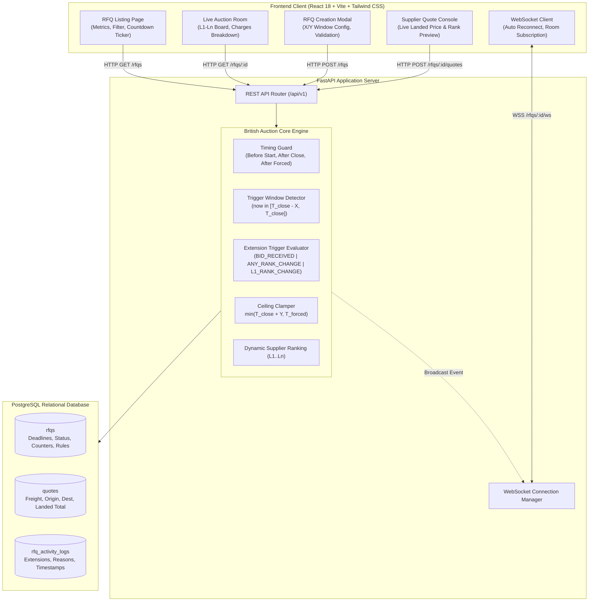
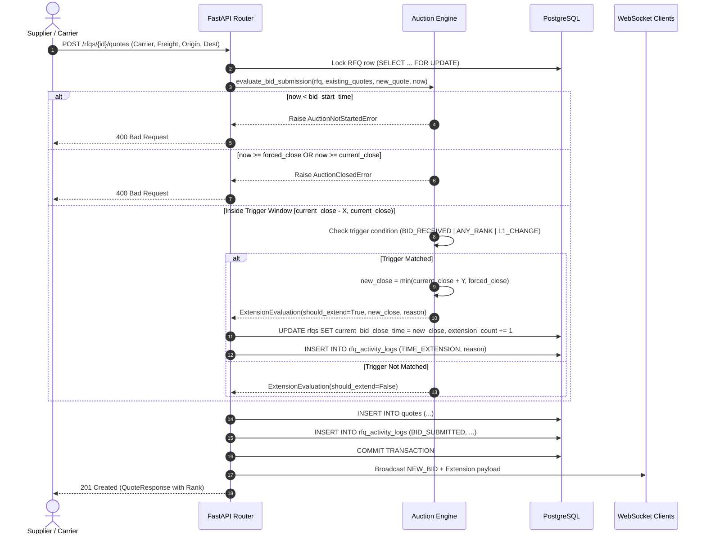

# High-Level Design (HLD): British Reverse Auction in RFQ System

## 1. System Overview & Context

This system implements a specialized **Request for Quotation (RFQ)** platform featuring **British Reverse Auction** bidding mechanics. 

In freight logistics and procurement, buyers publish RFQs for shipping routes (e.g., *20x 40ft containers from Shanghai to Rotterdam*). Competing carriers and freight suppliers submit quotations where **lower total landed costs win (Rank L1)**.

To eliminate **"bid sniping"** (submitting bids at the very last second so competitors cannot respond), the British Auction introduces an automatic dynamic extension window bounded by an inviolable **Forced Bid Close Time** hard ceiling.

---

## 2. System Architecture Diagram

---

## 3. Core British Reverse Auction Algorithm

### Trigger Window & Extension Parameters
- **Trigger Window ($X$ minutes)**: The time interval immediately preceding the current close time: $[T_{\text{close}} - X, T_{\text{close}})$.
- **Extension Duration ($Y$ minutes)**: The duration added to the close time when a trigger condition occurs: $T_{\text{close}} \leftarrow T_{\text{close}} + Y$.
- **Hard Forced Close Ceiling ($T_{\text{forced}}$)**: The absolute maximum time beyond which the auction cannot extend under any circumstance.

### Mathematical State Equation
$$\text{New Close Time} = \min(T_{\text{close}} + Y, T_{\text{forced}})$$

If $T_{\text{close}} \ge T_{\text{forced}}$, the auction is at its ceiling and no further extension is granted.

---

## 4. Trigger Modes Comparison

1. **`BID_RECEIVED` (Any Bid in Window)**:
   - Any quote submitted during the last $X$ minutes causes an automatic extension by $Y$ minutes, regardless of whether it is higher or lower than existing quotes.
2. **`ANY_RANK_CHANGE` (Rank Displacement in Window)**:
   - Extends the auction if any carrier's relative rank changes (e.g. Carrier B underbids Carrier A to become $L2$, while $L1$ stays intact).
3. **`L1_RANK_CHANGE` (Lowest Bidder Change in Window)**:
   - Extends the auction **only** when a new overall lowest quote ($L1$) emerges during the last $X$ minutes.

---

## 5. Concurrency & Data Integrity Strategy

- **Row-Level Locking**: Quote submission operations acquire an exclusive row lock (`with_for_update()`) on the target RFQ. This prevents race conditions when two suppliers submit competing bids simultaneously at the exact millisecond of deadline.
- **Strict Timezone Handling**: All timestamps are normalized and compared in UTC (`datetime.now(timezone.utc)`).
- **Audit Immutability**: All status transitions, price changes, and extension rationales are persisted in `rfq_activity_logs`.
